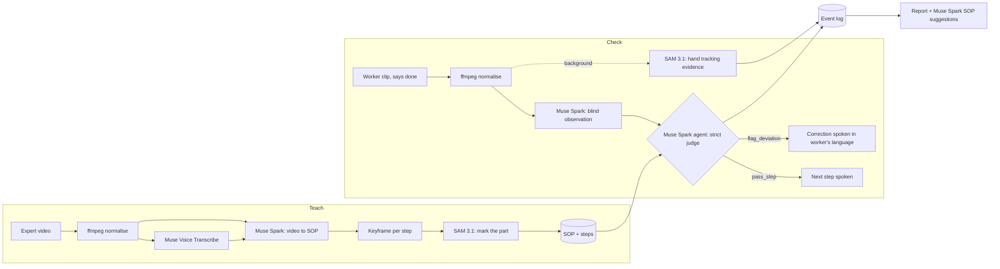

# ShopFloor Copilot

**An expert does a job once on camera. Every new worker then has that expert in their ear — each step checked by AI and corrected out loud, in their own language.**

Built on **Muse Spark**, **SAM 3.1** and **Muse Voice Transcribe** (Meta Model API) for the Meta Global AI Developer Hackathon · Indie Developer track · *Push the Frontier*.

**▶ Live demo:** https://shopfloor-copilot.onrender.com &nbsp;·&nbsp; **🎬 Demo video:** _add link_ &nbsp;·&nbsp; **📊 Results:** [100% on 12 real clips, 0 missed mistakes](#evaluation)

> Free hosting sleeps when idle — the first load can take ~1 minute.

---

## The problem

Skilled workers retire, contract and migrant workers turn over every few months, and their know-how leaves with them — it was never written down. In small factories there is usually no SOP at all, and nobody to check each step. Assembly mistakes are found at the end of the line, or by the customer.

The cost can be enormous: in July 2013 a Russian Proton-M rocket was lost because angular-velocity sensors were installed upside-down, and the investigating commission's proposed fix included filming installation work for review ([RIA Novosti via GlobalSecurity](https://www.globalsecurity.org/space/library/news/2013/space-130718-rianovosti01.htm)). ShopFloor Copilot does that review **automatically, step by step, while the work is being done**.

## What it does

| Mode | Who | What happens |
|---|---|---|
| **Teach** | Expert | Records the job once while narrating. Muse Voice Transcribe captures the narration; **Muse Spark watches the video** and writes a step-by-step SOP, each step with a *visible* end state; **SAM 3.1** marks the parts on each step's reference frame. The expert can edit any step. |
| **Check** | Worker | Works with a phone on their head (or any camera). After each step they say **"done"** (or ಮುಗಿತು / हो गया). A **Muse Spark agent** judges the clip against the SOP and calls a tool: `pass_step` → *"ಸರಿ. ಮುಂದಿನ ಹಂತ: …"*, or `flag_deviation` → one short spoken correction in **Kannada, Hindi or English**. SAM 3.1 tracks the hands as visual evidence for the supervisor. |
| **Report** | Supervisor | First-try pass rate, corrections by type, the most-failed step, every correction with its video evidence — and **Muse Spark proposes SOP changes** grounded in the correction data. |

## How Meta's models are used

| Model | Where | How |
|---|---|---|
| **Muse Spark 1.2** — video understanding | Teach | Expert video + timed narration → structured SOP (actions, parts, tools, end states, critical flags, timings) |
| **Muse Spark 1.2** — blind observation | Check | Describes what the hands did in a clip **without being told the expected step** (prevents confirmation bias) |
| **Muse Spark 1.2** — agent with tool calling | Check | Strict judge: SOP + expected end state + completed-step history + blind observation + the clip → `pass_step` / `flag_deviation(type, observed_step_id, reason, instruction_for_worker)` |
| **Muse Spark 1.2** — multilingual | Check | Translates steps once per language; writes corrections directly in Kannada / Hindi |
| **Muse Spark 1.2** — reasoning over data | Report | Proposes 3 SOP changes from the correction log |
| **SAM 3.1** — image segmentation | Teach | Highlights the step's part on its reference frame (short noun phrase, with fallbacks) |
| **SAM 3.1** — video tracking | Check | Tracks the worker's hands across the clip with stable IDs → evidence overlay video (built after the verdict, so it never slows the worker down) |
| **Muse Voice Transcribe** | Teach | Expert narration → timed turns that Spark aligns with the video |

## Architecture



**Stack:** FastAPI · SQLModel/SQLite · ffmpeg · OpenCV · React (Vite) · browser speech synthesis & recognition · one Docker container on Render.

## Design decisions that came from measurement

1. **Blind observation, then a strict judge.** Our first agent, told *"the expected step is X"*, invented evidence for X and passed a step that never happened. Describing the clip first, without the expected step, fixed it.
2. **Judge the result, not the motion.** The judge passes only when the step's end state is visible by the end of the clip; narration and similar-looking motions are never proof.
3. **Every step must end in something the camera can see.** "Loosen the screw" is invisible — a loosened screw looks like an untouched one. Merging it into "unscrew and remove the cap" took accuracy from 86% to 100%. Teach mode now enforces this rule.
4. **Look-alike steps need a visible difference.** Top and bottom caps look identical; the SOP names a feature (the silver stripe / USB-C end), and the judge only passes if it can see it.
5. **The judge knows which steps are already done** — a part removed earlier can't be removed again, which removes false alarms without letting mistakes through.
6. **Spoken corrections are one sentence, ≤12 words.** The full reason goes to the supervisor log.

## Evaluation

Every recorded clip is run through the real agent ([`backend/scripts/eval.py`](backend/scripts/eval.py)) against its own step (should pass) and against a different step (should flag), plus deliberate mistakes. Ground truth: [`eval/ground_truth.csv`](eval/ground_truth.csv).

| Metric | Result |
|---|---|
| Overall accuracy | **100%** (12 / 12) |
| Mistakes caught | **100%** (8 / 8) — **0 missed** |
| Correct work passed | **100%** (4 / 4) |
| False alarm rate | **0%** |
| Check time p50 / p90 | 18 s / 22 s |

How we got there:

| Run | Accuracy | Missed mistakes | Change |
|---|---|---|---|
| 1 | 86% | 1 | Baseline |
| 2 | 71% | 0 | Strict look-alike rule — safe, but too many false alarms |
| 3–4 | 86% | 0 | Exact step wording + completed-step history |
| 5 | **100%** | **0** | Every step ends in a visible state |

**Honest limits:** 12 judgements on 8 clips of one product, one camera position, one person. It shows the method works; it is not yet a production benchmark. Mistakes still to add to the set: wrong order, narration-only, skipping ahead.

## Try it

- **Live:** open the link → **Teach** → the demo SOP → choose a language → **Start Check mode** → do a step → hold the result up for 2 seconds → **Done** (or Space, or say "done").
- **Head-mounted:** open the link on a phone, strap it to a cap pointing at your hands, tick *Hands-free*.
- **Voices:** Kannada/Hindi speech works in Microsoft Edge (desktop) and Chrome on Android.
- The public demo is rate-limited to protect API credits.

## Run locally

Needs Python 3.10+, Node 20, ffmpeg and a Meta Model API key in `.env` (copy `.env.example`).

```bash
# backend
cd backend && pip install -r requirements.txt
uvicorn app.main:app --reload --port 8000

# frontend (second terminal)
cd frontend && npm install && npm run dev        # http://localhost:5173
npm run phone                                    # HTTPS on your Wi-Fi, for a phone camera

# tests (18, offline — Meta calls mocked)
cd backend && python -m pytest -q

# evaluation on your own clips
python scripts/eval.py --sop <id> [--repeats 2]
```

Deploy: `render.yaml` + `Dockerfile` (one container: React build + FastAPI). `python scripts/export_seed.py --sop <id>` packages an SOP as the built-in demo.

## Built during the hackathon

All code in this repository was written during the building period (27 Oct – 4 Nov 2026), in phases — see the commit history.

- API spikes for Muse Spark video, SAM 3.1 tracking, Voice Transcribe and tool calling ([`SPIKES.md`](SPIKES.md))
- Teach pipeline: transcription → Spark SOP → keyframes → SAM part highlighting; step edit/delete
- Check engine: blind observe → strict judge agent, multilingual corrections, step history, supervisor override, background SAM hand-tracking evidence
- React app: Teach, Check (camera, per-step recording, voice in/out, phone layout over HTTPS), Report (KPIs, Spark SOP suggestions, export)
- Evaluation harness with ground truth, and the measured results above
- Single-container deploy with demo seed and rate limits

## Layout

```
backend/app/services/meta_client.py   every Meta Model API call (Spark, SAM 3.1, Transcribe)
backend/app/services/teach.py         Teach pipeline
backend/app/services/check.py         Check engine (observe → judge → speak)
backend/app/services/report.py        shift report + Spark SOP suggestions
backend/scripts/eval.py               evaluation harness
frontend/src/pages/                   Teach, SopDetail, Check, Report
spikes/                               Phase 1 API experiments
eval/                                 ground truth + results
```

## Next

Live streaming instead of per-step clips · on-device judging with Muse Spark Open for factories without internet · Meta Ray-Ban glasses as the camera · multi-station dashboards.

## License

MIT